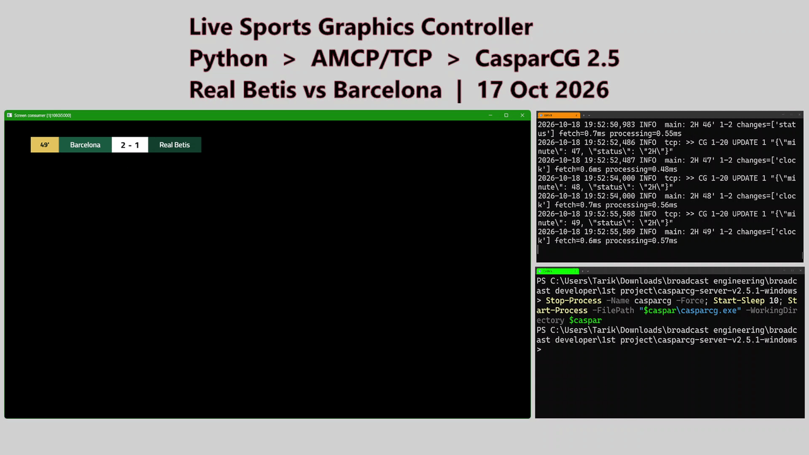
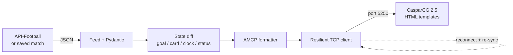

# Live Sports Graphics Controller


A Python service that turns football match data into live on-air graphics in **CasparCG**, with no operator input.
It reads match data, detects what changed (goals, cards, clock, VAR reversals) and drives an HTML scorebug
and event alerts over CasparCG's **AMCP** protocol on TCP.



▶ Full demo video: https://youtu.be/KEiJslkvsW8

> Built by a broadcast TX operator to connect live data feeds with playout graphics, the same way
> automation drives secondary events in a playlist.

## What it does

- Reads match data from API-Football, or replays recorded and rebuilt matches
- Validates every response with **Pydantic** before anything reaches the screen
- Sends only what changed between two snapshots, never the whole state again
- Fires a goal alert only when a score really increases; a VAR-cancelled goal updates the numbers with no celebration
- Credits own goals to the right team, ignores missed penalties and shoot-out kicks
- Keeps one TCP connection to CasparCG with keep-alive and automatic reconnect (backoff capped at 5 s)
- After any reconnect, re-sends the current full state, so the screen is correct again in one command
- Rebuilds any finished match minute by minute from a single API request
- Logs processing time per change and prints a summary when stopped

| Scorebug | Goal alert |
|---|---|
|  |  |

## Architecture



| Module | Responsibility |
|---|---|
| `app/feed.py` | Live API client, replay player, provider-to-model mapping |
| `app/models.py` | Pydantic models for match state, events and goals |
| `app/state.py` | Change detection between consecutive snapshots |
| `app/formatters.py` | AMCP command builder (`CG ADD`, `CG UPDATE`) |
| `app/transport.py` | TCP client: keep-alive, backoff, reply-code logging |
| `templates/` | CasparCG HTML templates: scorebug and event alert (Arabic, RTL, 1920×1080) |
| `tools/` | Mock CasparCG, AMCP console, template check, API helper, live recorder, match rebuilder |

### How code and template talk

CasparCG turns each AMCP command into a JavaScript call inside the template:

| AMCP command | Template function |
|---|---|
| `CG 1-20 ADD 1 scorebug 1 "{json}"` | loads the page, `update(json)`, then `play()` |
| `CG 1-20 UPDATE 1 "{json}"` | `update(json)` with only the changed fields |
| `CG 1-20 STOP 1` | `stop()` |

Field names are the contract: `homeScore` in Python must be `homeScore` in the template.

## Design decisions

**Discard, don't queue.** If CasparCG is offline, commands are dropped instead of buffered. A goal alert
two minutes late is worse than none. On reconnect the current full state is sent again.

**Celebrate on score increase, not on event.** Providers often deliver the score and the goal event in
different updates. Triggering on the score avoids missed or doubled alerts, and a lower score (VAR) is a plain update.

**Validate before air.** A malformed response is logged and skipped; the last good state stays on screen.

## Results

Measured on real matches from API-Football, replayed against CasparCG 2.5.1 on Windows 11 (NVIDIA GTX 960M):

| Metric | Value |
|---|---|
| Matches tested | Real Betis 2 - 5 Barcelona , Al-Sailiya 2 - 2 Qatar SC , and Manchester City 3 - 2 Ipswich |
| Processing time per change set (avg / p95 / max) | 0.52 ms / 0.91 ms / 1.80 ms |
| Reconnect after CasparCG restart | within 5 s, full state re-synced automatically |
| Unit tests | 16 passing, run on every push |

End-to-end delay on air is dominated by the data provider. The service logs it separately as fetch time.

## Run it

Requirements: Python 3.12, CasparCG Server 2.5 (Windows or Linux).

```bash
python -m venv .venv
.venv\Scripts\activate                     # Linux/macOS: source .venv/bin/activate
pip install -r requirements.txt
python tools/make_sample_recordings.py     # demo match: goals, cards, VAR, full time
python -m pytest -q
```

**Without CasparCG** (two terminals):

```bash
python tools/mock_engine.py
python -m app.main
```

**With CasparCG:**

1. In `casparcg.config` set `<video-mode>1080i5000</video-mode>`.
2. Copy `templates/*.html` into CasparCG's `template` folder (next to `casparcg.exe`).
3. Start CasparCG, then:

```bash
python tools/check_templates.py            # both templates step by step
python -m app.main
```

**A real finished match** (one API request):

```bash
python tools/api_check.py date 2026-10-17 "Premier League"
python tools/rebuild_match.py <fixture_id>
REPLAY_DIR=tools/recordings/rebuilt/<fixture_id> python -m app.main
```

### Settings (environment variables)

| Variable | Default | Meaning |
|---|---|---|
| `ENGINE_HOST` / `ENGINE_PORT` | 127.0.0.1 / 5250 | CasparCG AMCP address |
| `CASPAR_CHANNEL` | 1 | output channel |
| `SCOREBUG_LAYER` / `ALERT_LAYER` | 20 / 21 | layers on that channel |
| `TEMPLATE_BASE` | empty | load templates over HTTP instead of the template folder |
| `FEED` | replay | `replay` or `live` |
| `REPLAY_DIR` | tools/recordings | snapshot folder |
| `API_KEY` / `FIXTURE_ID` | — | API-Football key and match id |
| `POLL_INTERVAL` | 2 | seconds between snapshots |
| `LOG_FILE` | logs/sports-gfx.log | log file (empty to disable) |

## Project structure

```
app/          service code
templates/    CasparCG HTML templates (open with ?demo in a browser to preview)
tools/        mock_engine, amcp_console, check_templates, api_check,
              record_match, rebuild_match, make_sample_recordings
tests/        unit tests (diff logic, goal attribution, AMCP format)
docs/         development log and media
```

## Limits

- Tested with CasparCG's screen output; not tested with SDI output hardware.
- The free API plan allows 100 requests a day and a short date window, so development uses saved matches.
  Live mode works but needs a paid plan for a fast polling interval.
- Penalty shoot-outs are not shown on the scorebug.

## Development log

The problems met while building this and how each was solved: [docs/DEVELOPMENT_LOG.md](docs/DEVELOPMENT_LOG.md)

## Tech

Python 3.12 · asyncio · aiohttp · Pydantic · raw TCP sockets · AMCP · CasparCG HTML producer (CEF) · HTML/CSS/JS · pytest · GitHub Actions

## License

MIT
