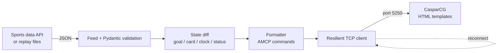

# Live Sports Graphics Controller

A Python service that turns a live football data feed into on-air graphics automatically.
It polls match data, detects what changed (goals, cards, clock, VAR reversals) and drives a
**CasparCG** HTML scorebug and event alerts over **AMCP/TCP**, with no operator input.

<!-- Add a demo GIF here:  -->

> Built by a broadcast TX operator to explore the gap between live data and playout automation.

## What it does

- Polls a sports data API (API-Football) or replays recorded match snapshots
- Validates every response with **Pydantic** before anything reaches the screen
- Detects changes between snapshots and sends **only** what changed
- Fires a goal animation only when a score really increases; a VAR-cancelled goal updates the numbers with no celebration
- Credits own goals to the right team, ignores missed penalties and shoot-out kicks
- Rebuilds any finished match minute by minute from one API request, so real matches can be replayed on air
- Keeps a resilient TCP connection to the graphics engine: keep-alive, automatic reconnect with exponential backoff, and a **full state re-sync** after every reconnect
- Logs processing latency per change

## Architecture



| Module | Responsibility |
|---|---|
| `app/feed.py` | Live API client, replay player, provider-to-model mapping |
| `app/models.py` | Pydantic models for match state, events, goals |
| `app/state.py` | Delta detection between consecutive snapshots |
| `app/formatters.py` | Engine-specific command builders (CasparCG; Viz as a stub) |
| `app/transport.py` | TCP client with keep-alive, backoff, reply-code logging |
| `templates/` | CasparCG HTML templates: scorebug and event alert (Arabic, RTL) |
| `tools/` | Mock engine, AMCP console, template test, API helper, live recorder, finished-match rebuilder |

## Design decisions

**Discard, don't queue.** If the engine is offline, commands are dropped rather than buffered.
Replaying a goal animation two minutes late is worse than skipping it. On reconnect the service
sends the current full state, so the screen is correct again within one command.

**Celebrate on score increase, not on event.** Providers often deliver the score and the goal
event in different updates. Triggering on the score avoids missed or duplicated celebrations,
and a score decrease (VAR) is handled as a plain update.

**One formatter per engine.** Feed, diff and transport know nothing about the engine. Supporting
another engine means writing one formatter class.

## Results

Measured on a replayed 90-minute match against CasparCG 2.5.1 on Windows (GTX 960M):

| Metric | Value |
|---|---|
| Processing time per change set (avg / max) | _fill in from the log_ ms |
| Recovery after engine restart | _fill in_ s, state re-synced automatically |
| Unit tests | 12 passing (diff logic, VAR reversal, late events, own goals, missed penalties, AMCP escaping) |

Note: end-to-end delay is dominated by the data provider's own latency, which is outside this service and logged separately as fetch time.

## Run it

```bash
python -m venv .venv
.venv\Scripts\activate                 # Linux/macOS: source .venv/bin/activate
pip install -r requirements.txt
python tools/make_sample_recordings.py
python -m pytest -q
```

Without CasparCG:
```bash
python tools/mock_engine.py            # terminal 1
python -m app.main                     # terminal 2
```

With CasparCG: copy `templates/*.html` into CasparCG's `template` folder, start the server, then
```bash
python tools/test_templates.py         # checks both templates
python -m app.main
```

Settings are environment variables: `ENGINE_HOST`, `ENGINE_PORT`, `FEED` (`replay`/`live`),
`API_KEY`, `FIXTURE_ID`, `POLL_INTERVAL`, `TEMPLATE_BASE`.

## Status and limits

- Tested on CasparCG 2.5.1 with the screen consumer; not tested with SDI output hardware.
- The Viz Engine formatter is an untested stub written from protocol documentation; I had no access to a Viz Engine.
- Live mode is limited by the data provider's request quota; development uses recorded snapshots.

## Next steps

- Push-based feed (WebSocket) to cut provider latency
- Viz Engine support once hardware access is available
- Dockerised deployment with health checks

## Tech

Python 3, asyncio, aiohttp, Pydantic, raw TCP sockets, AMCP, CasparCG HTML producer (CEF), HTML/CSS/JS
